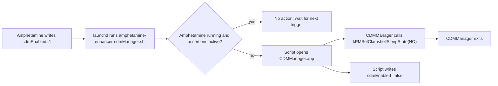

# CDMManager and Amphetamine Enhancer Interaction Flow
## Purpose
This document summarizes the complete runtime flow between the main **Amphetamine Enhancer** app, its launch agent/script, Amphetamine state, and the bundled **CDMManager** utility.

## Components involved
- Main app: `Xcode Project/Amphetamine Enhancer/AppDelegate.m`
- Launch agent plist: `Xcode Project/Amphetamine Enhancer/Launch Agents/amphetamine-enhancer-cdmManager.plist`
- Optional watch-path plist variant: `Xcode Project/Amphetamine Enhancer/Launch Agents/amphetamine-enhancer-closedDisplaySleep.plist`
- Script: `Xcode Project/Amphetamine Enhancer/Scripts/amphetamine-enhancer-cdmManager.sh`
- Helper app: `Xcode Project/CDMManager/CDMManager/AppDelegate.m`
- Build wiring: `Xcode Project/Amphetamine Enhancer.xcodeproj/project.pbxproj`

## Build-time packaging flow
1. The main Xcode project references `CDMManager.xcodeproj`.
2. A Copy Files build phase embeds `CDMManager.app` into the main app bundle under:
   - `Amphetamine Enhancer.app/Contents/Resources/CDMManager/CDMManager.app`
3. The script and plist resources are also bundled into the main app resources.

## Install/setup flow in the main app
1. User installs the enhancement via the main UI.
2. Main app copies `amphetamine-enhancer-cdmManager.plist` to:
   - `~/Library/LaunchAgents/`
3. Main app loads it with `launchctl load -w`.
4. On launch, main app removes quarantine xattrs on the embedded helper to ensure it can be opened:
   - `xattr -r -d com.apple.quarantine .../Resources/CDMManager/CDMManager.app`

## Runtime control flow (end-to-end)
1. `launchd` triggers the cdmManager script (every 10 seconds via `StartInterval` in plist).
2. Script reads shared state from Amphetamine defaults:
   - `defaults read com.if.Amphetamine cdmEnabled`
3. If `cdmEnabled != 1`, script exits.
4. If `cdmEnabled == 1`, script evaluates safety conditions:
   - Is Amphetamine running? (`pgrep -x Amphetamine`)
   - Does Amphetamine currently hold power assertions? (`pmset -g assertions | grep "Amphetamine"`)
5. If conditions indicate closed-display override should be cleared, script launches helper:
   - `open /Applications/Amphetamine Enhancer.app/Contents/Resources/CDMManager/CDMManager.app`
6. Script then writes:
   - `defaults write com.if.Amphetamine cdmEnabled -bool false`
7. `CDMManager.app` starts, executes one IOKit call:
   - `IOConnectCallScalarMethod(..., kPMSetClamshellSleepState, input=NO)`
8. `CDMManager.app` terminates immediately.

## State-sharing / IPC model
There is **no direct bidirectional IPC** between the main app and `CDMManager` (no XPC/socket/custom protocol).
The mechanism is:
- **launchd scheduling/watch triggers**
- **shared preference state** in `com.if.Amphetamine` (`cdmEnabled`)
- **system process/power-state checks** (`pgrep`, `pmset`)
- **fire-and-forget app launch** (`open ...CDMManager.app`)

## Practical sequence diagram

## Key observations
- `CDMManager` is intentionally minimal and stateless: perform one kernel power-management call, then exit.
- The script contains the decision logic; helper app contains the privileged/low-level operation.
- Shared defaults key (`cdmEnabled`) is the main coordination flag across app boundaries.
